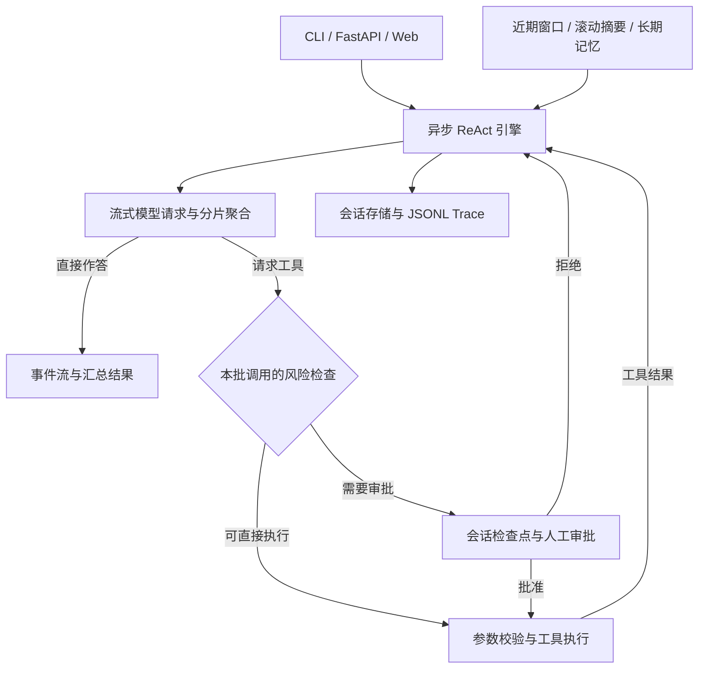

# study-agent

`study-agent` 是一个 Python 通用 Agent 框架，面向流式交互、受控工具执行和可验证的运行流程。当前 V1.0 已交付单机运行时和 Web 工作台，CLI、HTTP API 与离线评测共用执行内核。V2.0 正在推进独立运行和通用编排，V2.5 是通用框架的最终目标版本。

## 项目介绍

### 运行架构



### 已实现能力

| 模块 | 实现与行为 |
| --- | --- |
| **异步 ReAct 与事件流** | 把模型生成、工具执行和人工审批组织为异步执行循环。统一 `AgentEvent` 承载回复增量、执行步骤、工具结果、审批和错误。CLI 消费事件，FastAPI 编码为 SSE。支持单进程内同会话互斥、重复工具调用检测和步数上限。 [执行引擎](agent/engine/core.py) · [事件协议](agent/engine/events.py) |
| **模型适配与故障处理** | 通过 `LLMClient` 接入 OpenAI 兼容服务，聚合文本及工具参数分片。符合条件的异常可在首个分片发出前退避重试并切换备用模型。已开始输出时上报中断状态，避免拼接两次生成的内容。 [模型适配](agent/llm/provider.py) |
| **声明式工具与受控执行** | 从 Python 函数签名生成 Pydantic 参数模型和 OpenAI 工具 Schema。运行时注入会话、用户标识及工作区，统一处理并发、等待超时、错误反馈和结果截断，按调用顺序回填结果。内置 AST 白名单计算器和工作目录受限的文件写入工具。 [工具注册](agent/tools/base.py) · [工具执行](agent/tools/executor.py) · [内置工具](agent/tools/builtin.py) |
| **分层记忆与持久化** | L1 按目标 Token 预算选取完整轮次，始终保留最新一轮并维护工具消息配对。L2 对滑出窗口的历史进行异步滚动摘要，写回时检查会话和摘要进度。L3 按用户标识分组，以 BM25 检索跨会话事实。会话 JSON 使用临时文件及原子替换完成落盘。 [窗口裁剪](agent/memory/window.py) · [摘要与上下文](agent/memory/manager.py) · [长期记忆](agent/memory/long_term.py) · [会话存储](agent/memory/store.py) |
| **HITL 人工审批** | 在执行含高风险动作的工具批次前，保存待审批调用和对话上下文，再发出审批事件。支持整批审批及按工具调用 ID 决策。恢复后执行获准动作，把拒绝结果反馈给模型，并在继续生成前保存更新后的会话。 [审批与恢复](agent/engine/core.py) · [状态模型](agent/state.py) |
| **Trace、工作台与 API** | Trace 关联上下文、模型和工具步骤，记录耗时、异常及可获得的 Token 用量。CLI 可通过 `/trace` 查看瀑布图。Web 提供流式回复、工具状态、审批卡片和会话管理。FastAPI 提供同步与流式对话、审批恢复及会话接口，可配置共享 API Key。 [追踪实现](agent/observability/tracer.py) · [HTTP 接口](app/main.py) · [Web 工作台](app/static/index.html) |
| **组件替换与离线测试** | `build_agent()` 统一组装模型、工具、存储、Trace 导出器和故障注入器。CLI、Web 和评测使用同一运行时，测试可通过模拟模型和内存存储复现指定执行路径。 [组件组装](agent/factory.py) · [测试替身](tests/conftest.py) |

### 验证结果

**52 项自动化测试通过，12 条离线回放用例达标。** 覆盖流式分片、工具并发与超时、分层记忆、审批、SSE 和会话接口。另用模拟模型完成跨进程检查点验证。新进程可读取待审批会话，批准后写入文件，拒绝后目标文件未创建。 [自动化测试](tests/) · [回放用例](eval/datasets/golden_cases.jsonl) · [评测程序](eval/run_eval.py)

| 离线评测指标 | 验证结果 | 口径 |
| --- | --- | --- |
| 工具轨迹召回率 | 100% | 检查轨迹是否包含预期工具。 |
| 未注册工具调用占比 | 0% | 统计回放过程中出现的未注册工具。 |
| 规则事实忠实度 | 5.00 / 5.00 | 依据预期事实与成功工具结果的文本匹配评分。 |
| 韧性用例通过率 | 4 / 4 | 覆盖审批拒绝、参数纠正、首次超时及不受支持的计算表达式。 |

以上为脚本化模型驱动实际引擎与内置工具的离线回归结果。评测程序另提供真实模型入口 `--live`。

## 项目进度

| 版本 | 状态 | 交付内容与目标 |
| --- | --- | --- |
| **基础版** | 已归档 | 交付 CLI 多轮对话、OpenAI 兼容模型、ReAct 循环、内置工具和 JSON 记忆。 [基础版归档](https://github.com/wq123908/study-agent/tree/codex/basic) |
| **V1.0** | 已归档 | 交付异步流式运行时、声明式工具、分层记忆、HITL、Trace、Web 工作台和离线评测。代码基线为 `542fa2b`。 [V1.0 归档](https://github.com/wq123908/study-agent/tree/codex/v1.0) |
| **V2.0** | 开发准备 | `main` 继承 V1.0 基线。独立运行记录尚未实现，是当前开发起点。目标是统一任务契约、运行生命周期、工具策略、Workflow 和评测入口。 |
| **V2.5** | 已规划 | 通用框架最终目标版本。计划在 V2.0 内核上提供可选能力组件，按部署规模接入共享服务能力。 |

`main` 承载当前版本开发和全项目文档。V2.0 验收后进入版本归档，`main` 继续推进 V2.5。归档分支的 README 记录对应版本。上表使用项目里程碑编号，当前 Python 包版本为 `0.2.0`。

### V2.0 建设进度

| 阶段 | 计划能力 | 验收目标 |
| --- | --- | --- |
| **13 · 任务契约** | 独立运行记录、结构化输入输出和产物引用。 | 同一会话可查询多次运行的独立状态和结果。 |
| **14 · 生命周期** | 运行查询、持久化、截止、取消和恢复。通用挂起支持等待补充输入、审批或外部信号。 | 任务可脱离原连接，从持久检查点继续。 |
| **15 · 工具与策略** | 结构化工具结果、错误和执行回执。支持权限、模型及工具的数据发送约束、运行预算和写操作防重。 | 对超时、异常结果和重复请求有明确的状态与处理路径。 |
| **16 · Agent 定义与编排** | 配置与版本绑定、模型能力匹配、知识来源与上下文管理，组合确定性步骤、ReAct、分支和子任务。 | 问答与审批流程共用内核，各自声明能力与流程。 |
| **17 · 质量与审计** | 逐回复评测、任务成功条件、运行证据关联及脱敏回放。 | 回答可按证据评分，任务失败可定位到执行步骤。 |
| **18 · 接入与兼容** | 稳定的 Python 与 HTTP 接口、CLI 和 Web 集成、状态与事件版本约定。 | 保留基线回归，并从不同入口执行和追踪新任务。 |

### V2.5 的架构与能力

V2.5 将沿用 V2.0 的任务、工具、编排、上下文和观测接口。各 Agent 可按任务启用能力组件，部署保障根据使用规模配置。

| 计划扩展 | 用途 |
| --- | --- |
| **MCP、A2A 与多 Agent 协作** | 接入外部工具、资源或独立 Agent，复用调用权限、审批、任务状态与 Trace。 |
| **规划、待办与技能包** | 复用工作流步骤、工具集合与验证约定，并管理多步骤任务的进度。 |
| **向量检索与多模态解析** | 以可追溯的来源和产物引用，将检索结果、文档和图片信息提交给运行时。 |
| **定时触发** | 通过计划或外部事件发起任务，复用任务状态与结果接口。 |
| **共享服务部署** | 按环境接入租户隔离、配额、共享队列、多 Worker、发布回滚、应急停用和备份恢复。 |

V3 是后续仿真业务阶段，基于已验收的 V2.0 内核和业务所需的 V2.5 组件，验证正常处理、人工审批或拦截以及故障恢复。

## 运行说明

在仓库根目录使用 Python 3.11 或更高版本。以下为 PowerShell 命令。

```powershell
python -m venv .venv
.\.venv\Scripts\python.exe -m pip install "openai>=1.40" "python-dotenv>=1.0" "pydantic>=2.7" "fastapi>=0.110" "uvicorn>=0.29" "pytest>=8" "pytest-asyncio>=0.23" httpx
```

离线验证使用模拟模型。

```powershell
.\.venv\Scripts\python.exe -m pytest -q
.\.venv\Scripts\python.exe -m eval.run_eval
```

启动对话前，从 [配置模板](.env.example) 创建 `.env` 并填写 `DEEPSEEK_API_KEY`。运行下列命令之一启动 CLI 或 Web。Web 地址为 [127.0.0.1:8000](http://127.0.0.1:8000/)。

```powershell
# CLI
.\.venv\Scripts\python.exe main.py

# Web
.\.venv\Scripts\python.exe -m uvicorn app.main:app --host 127.0.0.1 --port 8000
```
