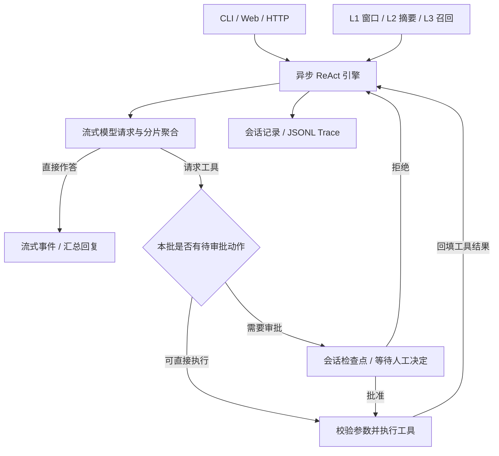

# study-agent

从零手写的 Python Agent 框架。当前可在 CLI 和 Web 中流式对话、并行调用工具、检索跨会话记忆，并在高危写操作前挂起等待人工审批。模型调用、工具执行、会话状态和追踪都能在同一套引擎中观察和离线复测。

**当前交付** · V1.0 单机运行基线 · 52 项自动化测试通过 · 12 条确定性回放用例达标

**开发路线** · `main` 正在进入 V2.0 · V2.5 是通用框架的最终目标版本

[已实现的核心能力](#已实现的核心能力) · [当前验证结果](#当前验证结果) · [本地运行与演示](#运行当前代码) · [版本与当前进度](#版本与当前进度) · [V2.5 目标架构](#v25-的架构与能力)

## 已实现的核心能力

### 1. 异步 ReAct 与统一事件流

引擎在每一步准备上下文和工具清单，调用模型，判断是否需要执行工具，再把工具结果追加进消息历史交给模型。普通回复、工具执行、审批和错误都会产生 `AgentEvent`。CLI 直接消费事件，FastAPI 将同一批事件序列化为 SSE，Web 据此逐段显示回复、工具状态和审批卡片。非流式 HTTP 接口复用事件汇总逻辑。

引擎在同一进程内限制同一会话的并发运行，拦截本轮重复工具请求。达到步数上限或触发循环护栏时，收回工具并让模型总结当前结果。组装工厂允许注入模型客户端、工具注册表、会话存储、Trace 导出器和故障注入器，CLI、Web 和评测共用这套入口。 [执行引擎](agent/engine/core.py) · [事件协议](agent/engine/events.py) · [护栏](agent/engine/guardrails.py) · [组装工厂](agent/factory.py)



### 2. 模型适配、流式聚合与降级

- **可替换客户端**。通过 `LLMClient` 约定流式生成和普通生成接口，当前适配 OpenAI 兼容服务。测试和评测可注入脚本化模型。
- **组装分片**。把分批返回的文本、供应商提供的推理字段以及工具调用参数聚合成一条完整消息，同时向调用方持续发送增量事件。
- **处理瞬时故障**。在还未向调用方发出分片时，对符合条件的错误执行带抖动的退避重试，配置了备用模型时可以降级。已经发出分片后，把流中断报告给调用方，避免拼接来自两次生成的回复。 [模型适配实现](agent/llm/provider.py) · [流式聚合与降级测试](tests/test_llm.py)

### 3. 声明式工具与受控执行

- **从 Python 函数生成工具契约**。注册表根据函数签名与类型生成 Pydantic 参数模型和 OpenAI 工具 Schema，拒绝未声明的字段。会话、用户标识和工作区等执行上下文由运行时注入。
- **批量执行与错误反馈**。同步工具经线程池执行，异步工具由事件循环调度。同批调用限制并发，按输入顺序回填结果。参数错误、执行超时和工具异常会形成可供模型判断的结果。
- **内置能力可直接演示**。提供时间查询、AST 白名单计算、记忆写入与检索，以及受工作目录约束的文本写入。不同工具具有只读、写入和高风险等标签。 [工具注册](agent/tools/base.py) · [工具执行](agent/tools/executor.py) · [内置工具](agent/tools/builtin.py) · [并发和参数校验测试](tests/test_tools.py)

### 4. L1/L2/L3 分层记忆与本地状态

| 层次 | 功能 | 实现要点 |
| --- | --- | --- |
| **L1 · 当前上下文** | 让模型看到最近且完整的对话。 | 按目标 Token 预算和轮次裁剪，始终保留最新一轮，清理孤立工具消息、补齐缺失的工具响应。 |
| **L2 · 滚动摘要** | 保留滑出窗口的历史信息。 | 在达到阈值后异步摘要，记录已摘要位置，写回时核对会话快照与摘要进度，避免旧任务覆盖新的摘要。 |
| **L3 · 长期记忆** | 在同一用户标识下跨会话找回事实或偏好。 | 对本地记录执行 BM25 召回，支持中文单字及二元组，把命中的记忆交给上下文构建器。 |

每个会话使用独立 JSON 记录，保存消息、工具调用、摘要和待审批状态。默认使用临时文件及原子替换完成落盘，存储接口也提供内存实现用于测试。 [上下文窗口](agent/memory/window.py) · [滚动摘要协调](agent/memory/manager.py) · [BM25 记忆](agent/memory/long_term.py) · [会话存储](agent/memory/store.py)

### 5. HITL 人工审批与工具副作用

当一批工具调用包含待审批的高风险动作时，引擎先把当前步骤、调用 ID 及上下文写入会话检查点，再发出 `approval_required`。终端可以继续交互，Web 可以展示待审批参数。审批接口支持整批批准或拒绝，也可以按工具调用 ID 分别决定。

从检查点续跑时，引擎执行获准的高风险动作，把被拒绝的动作标为拒绝并反馈给模型，其余合法调用可以继续。引擎在进入下一次生成前保存执行后的会话状态。以文本写入为例，审批决定能直接通过工作区是否生成文件验证。 [审批与恢复](agent/engine/core.py) · [检查点数据结构](agent/state.py) · [HTTP 审批测试](tests/test_api.py)

### 6. Trace、Web 工作台与接口

- **运行诊断**。Trace 汇总模型、工具和记忆相关的子步骤，记录耗时、错误和可获得的 Token 用量。流式模型阶段记录首 Token 时间。默认导出 JSONL，CLI 可以用 `/trace` 查看最近一次追踪的瀑布图。
- **本地工作台**。原生 Web 页面提供流式回复、工具调用过程、审批卡片和会话切换。每次对话可以使用显式的会话 ID，API 可在本地部署时配置共享 API Key。
- **HTTP 入口**。`POST /v1/chat` 获取汇总回复，`POST /v1/chat/stream` 订阅 SSE，`POST /v1/chat/approve` 恢复审批，`/v1/sessions` 提供会话查询与管理，`GET /healthz` 供本地启动自检。 [Trace 实现](agent/observability/tracer.py) · [瀑布图](agent/observability/view.py) · [FastAPI 入口](app/main.py) · [Web 工作台源码](app/static/index.html)

## 当前验证结果

**52 项自动化测试通过。** 测试覆盖模型分片聚合与备用模型、工具参数与并发、记忆裁剪与 JSON 存储、同会话互斥、审批批准和拒绝，以及 FastAPI 的 SSE 与会话接口。 [测试目录](tests/)

另做了本地跨进程检查点验证。用离线模型触发审批并保存 JSON 会话，退出后由新进程加载记录。批准路径生成了正确的文件，拒绝路径保留了拒绝结果，目标文件未创建。

**12 条确定性回放用例达标。** 评测用脚本化模型给出固定的工具调用，实际执行框架与内置工具。用例包括只读问答、多工具、读写记忆、审批、参数纠正与首次超时注入。 [黄金用例](eval/datasets/golden_cases.jsonl) · [评测程序](eval/run_eval.py)

| 离线评测项 | 本次结果 | 判定口径 |
| --- | --- | --- |
| 工具轨迹召回率 | 100% | 预期工具出现在本轮调用轨迹，直接回答用例要求无工具调用。 |
| 未注册工具率 | 0% | 统计回放轨迹中未出现在工具注册表的调用。 |
| 规则事实忠实度 | 5.00 / 5.00 | 检查回复是否包含预期事实，以及与成功工具结果的文本匹配情况。 |
| 韧性用例通过率 | 4 / 4 | 本组覆盖审批拒绝、参数纠正、首次超时和不支持的计算表达式。 |

这些数字衡量离线回放在当前规则下的回归表现。评测程序另有真模型运行入口 `--live`，需要配置模型 API Key。

## 版本与当前进度

| 版本 | 建设目标 | 已完成与下一步 |
| --- | --- | --- |
| **基础教学版** `v0.1.0-basic` | 从零写出一个能在终端多轮对话、调用工具并保存历史的 ReAct Agent。 | **已完成阶段 1–8。** 实现模型对接、消息、JSON 记忆、工具调用、ReAct 循环与基础护栏。见 [基础版归档](https://github.com/wq123908/study-agent/tree/codex/basic) 与 [学习记录](study_records/stage_01_08_review.md)。 |
| **V1.0** | 把基础 Agent 扩展成可用 CLI 和 Web 操作的单机框架，并建立离线回归。 | **已完成阶段 1–12 和 Web 工作台。** 已有声明式工具、并发执行、异步流式 ReAct、L1/L2/L3 记忆、人工审批、Trace、FastAPI/SSE、52 项测试和 12 条离线回放用例。代码基线为 `542fa2b`，见 [V1.0 归档](https://github.com/wq123908/study-agent/tree/codex/v1.0)。 |
| **V2.0** | 形成可嵌入、可编排、可恢复的通用内核，让不同 Agent 共用运行、工具、状态和评测机制。 | **当前在 `main` 开发。** 当前代码继承 V1.0 基线，阶段 13–18 待逐课实现。第一课是 13.1 独立运行记录。 |
| **V2.5** | 完成框架的能力扩展与部署适配，使常用组件能通过稳定接口按需装配。 | **已规划，待实现。** 优先用实际适配器验证工具、上下文和任务入口的扩展能力，再按部署需求补运行保障。 |

上表采用学习路线的版本名称。仓库的当前 Python 包版本为 `0.2.0`，历史 Git 标签 `v0.2.0` 保留阶段 9–12 的参考实现，可用于回顾当时的架构。

## 分支安排

- **`main`** 承载当前手写开发和全项目 README。先完成 V2.0，再推进 V2.5。
- **`codex/basic`、`codex/v1.0`** 保留已完成版本，每个分支的根目录 README 只介绍该版本。
- **`codex/v2.0`** 在 V2.0 验收后作为归档分支发布。V2.5 完成时由 `main` 承载框架最终版。

## V2.5 的架构与能力

### 通用内核

V2.5 将沿用 V2.0 的通用内核。简单问答可以只使用模型、任务结果与观测，涉及写入的工作流可以加入工具、证据校验、人工审批和恢复。下面是 V2.0 至 V2.5 的建设目标。

| 能力域 | 计划提供的能力 | 可验收的表现 |
| --- | --- | --- |
| 任务契约 | 结构化输入和输出、统一事件、结果与产物引用。 | 同一调用方能独立查询任务运行状态与最终结果。 |
| Agent 定义与版本 | 声明模型、工具和知识来源，选择输出契约、成功条件和策略。一条运行关联实际使用的配置版本。 | 新增 Agent 可复用运行内核，旧审批可按关联版本核对。 |
| 模型适配 | 声明流式生成、工具调用与结构化输出能力，按任务选择兼容模型。 | 可替换模型的任务保持同一输入与结果契约。 |
| 工具与外部能力 | 统一工具输出、错误、执行回执和防重语义。 | 外部工具返回异常时可定位失败，模拟写入重试后只产生一次可见结果。 |
| 通用编排 | 把确定性步骤、ReAct、条件分支、并行和子任务组合成 Workflow。 | 只读问答和审批流程能共用内核，各自声明执行步骤。 |
| 生命周期与恢复 | 独立运行标识、状态查询、截止、取消、检查点和通用挂起。支持等待输入、人工审批或外部完成信号。 | 一项任务可以脱离原连接恢复，异常终止时能查到最终状态。 |
| 上下文与知识 | 记录来源、有效期与访问范围，提供可插拔检索入口和上下文预算。 | 可核对模型使用了哪条证据，已过期的信息可被替换。 |
| 权限与执行策略 | 对模型和工具请求应用身份、权限、数据发送与预算约束；允许受权人工接管。 | 相同规则覆盖执行入口、审批恢复和工具调用。 |
| 质量与观测 | 关联单次运行的事件、审批、工具回执与 Trace。提供逐回复评分、任务成功条件、回归和脱敏回放入口。 | 答案与证据不符时能记录评分，任务失败时可定位到相应执行步骤。 |
| 接入与升级 | 稳定的 Python 与 HTTP 接口，明确配置、状态和事件的版本约定。 | CLI、Web 和程序调用方式可以使用同一套运行机制。 |

### 可选能力组件

| 组件 | 复用的内核接入点 | 计划用途 |
| --- | --- | --- |
| MCP | 工具注册、参数与结果契约、执行策略 | 把外部工具或资源接入现有审批、超时和 Trace。 |
| A2A、多 Agent 协作 | 任务、事件、结果和子任务 | 向外部 Agent 委派任务，保留运行状态与结果关联。 |
| 规划与待办、技能包 | Agent 定义和 Workflow | 在多个 Agent 之间复用一组指令、工具及验证约定。 |
| 向量检索、多模态解析 | 上下文和产物接口 | 让文档、图片或向量召回结果以可追溯证据进入运行。 |
| 定时触发 | 任务入口和运行状态 | 由计划或事件发起任务，调用统一的状态和结果接口。 |

可以先选一个工具适配器和一个上下文适配器验证接入方式。各 Agent 按任务声明启用所需组件。

### 共享部署能力

| 部署目标 | 计划能力 |
| --- | --- |
| 多人或多系统共享 | 接入身份，隔离会话、任务和数据，支持租户配额。 |
| 跨进程执行 | 接入共享任务队列和多 Worker，协调同一任务的执行权与状态。 |
| 持续运营 | 支持发布回滚、应急停用和备份恢复，并按部署目标验收。 |

本地学习和仿真任务可以使用单实例。共享部署能力随实际使用规模接入。

### V3 仿真业务

V3 使用已验收的 V2.0 内核和首个仿真业务所需的 V2.5 组件。应用交付关注仿真数据、业务规则、业务工具和端到端用例，覆盖正常处理、审批或拦截以及故障恢复。首个方向的背景见 [冷链实战规划档案](study_records/coldchain_agent/README.md)。

## V2.0 手写路线

| 阶段 | 手写内容 | 验收重点 |
| --- | --- | --- |
| **13 · 运行模型** | 任务输入、独立运行记录和任务结果。 | 一个会话内的两次运行各有标识和状态，记录可完整读回。 |
| **14 · 运行生命周期** | 保存、查询、通用挂起、恢复和取消。 | 可从挂起状态继续原任务，并用现有 HITL 验证。 |
| **15 · 工具与执行策略** | 结构化工具结果、回执、权限、预算和防重。 | 工具超时、异常结果与重复请求都有明确处理。 |
| **16 · Agent 定义与编排** | 模型、工具、记忆配置及确定性步骤与 ReAct 的组合。 | 问答与审批流程可共用内核，并各自声明能力。 |
| **17 · 结果判定与逐回复评分** | 任务成功条件、回复评测、证据记录和回归用例。 | 工具失败时任务状态准确，评分能指出回答和证据的偏差。 |
| **18 · 接口与兼容验收** | 把运行、状态查询和追踪接回 CLI 与 FastAPI。 | 原有用例继续通过，新任务可完整执行和追溯。 |

每次只学习一个模块。AI 在对话里说明模块的位置和原理，给出完整代码、文件位置、运行命令与预期。学习者亲手录入并运行，验收通过后再记录结果并进入下一节。见 [学习档案与接续规则](study_records/README.md)。

## 运行当前代码

以下命令用于 `main` 当前的可运行基线。在仓库根目录打开 PowerShell，使用 Python 3.11 或更高版本。

### 创建环境

```powershell
python -m venv .venv
.\.venv\Scripts\python.exe -m pip install "openai>=1.40" "python-dotenv>=1.0" "pydantic>=2.7" "fastapi>=0.110" "uvicorn>=0.29" "pytest>=8" "pytest-asyncio>=0.23" httpx
```

### 离线测试与评测

以下两条命令使用模拟模型，无需模型 API Key。

```powershell
.\.venv\Scripts\python.exe -m pytest -q
.\.venv\Scripts\python.exe -m eval.run_eval
```

### CLI 与 Web 工作台

首次启动前，从模板创建 `.env`，填写 `DEEPSEEK_API_KEY`。使用兼容 OpenAI 协议的模型服务时，可以同时配置 `DEEPSEEK_BASE_URL` 和 `DEEPSEEK_MODEL`。

```powershell
if (-not (Test-Path .env)) { Copy-Item .env.example .env }
```

启动 CLI。

```powershell
.\.venv\Scripts\python.exe main.py
```

启动 Web 工作台后，访问 [本地对话页](http://127.0.0.1:8000/)。

```powershell
.\.venv\Scripts\python.exe -m uvicorn app.main:app --host 127.0.0.1 --port 8000
```

### 快速演示

1. 在 Web 输入「告诉我现在的时间，并计算 2 的 10 次方」，观察工具选择、工具结果和流式回答。
2. 选用一个尚未使用的文件名，例如 `inspection.md`。输入「把今日巡检正常写入 `inspection.md`」。当模型请求写工具时，审批卡片会显示拟执行的动作。拒绝后确认目标文件尚未创建，重新发起并批准后查看默认工作区 `data/workspace/inspection.md`。
3. 在 CLI 对话后输入 `/trace`，查看最近一次运行的模型、工具与耗时。

Web 示例中的工具选择会随配置的模型而变化。可用下面的离线测试稳定复现 HTTP 流式审批与写入检查。

```powershell
.\.venv\Scripts\python.exe -m pytest -q tests/test_api.py::test_sse_stream_and_hitl_approval_over_http
```

## 当前代码入口

| 目录或文件 | 职责 |
| --- | --- |
| [`main.py`](main.py)、[`app/`](app/) | CLI、FastAPI、SSE 和 Web 工作台。 |
| [`agent/engine/`](agent/engine/)、[`agent/factory.py`](agent/factory.py) | ReAct 执行、事件、人工审批、护栏与组件组装。 |
| [`agent/llm/`](agent/llm/)、[`agent/tools/`](agent/tools/)、[`agent/memory/`](agent/memory/) | 模型接入、工具注册和执行、分层记忆。 |
| [`agent/observability/`](agent/observability/)、[`eval/`](eval/)、[`tests/`](tests/) | Trace、离线回放评测和自动化测试。 |
| [`study_records/`](study_records/) | 学习进度、阶段验收与手写规则。 |
