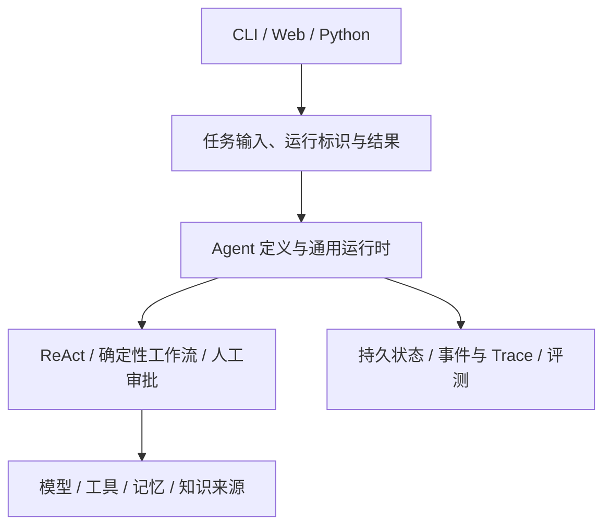

# study-agent

`study-agent` 是一个从零手写的 Python 通用 Agent 框架。它把模型调用、工具、记忆、工作流、人工审批和评测组合在同一个运行时里。简单任务可以只启用模型和结果校验，复杂任务可以加入外部工具、状态恢复和人工审批。

**V2.5 是通用框架的最终目标版本。** 它由 V2.0 的通用内核、按任务启用的能力组件，以及按部署规模选用的服务能力组成。V1.0 已完成归档，目前在 `main` 进入 V2.0，准备开始阶段 13。

## 版本与当前进度

| 版本 | 建设目标 | 已完成与下一步 |
| --- | --- | --- |
| **基础教学版** `v0.1.0-basic` | 从零写出一个能在终端多轮对话、调用工具并保存历史的 ReAct Agent。 | **已完成阶段 1–8。** 实现模型对接、消息、JSON 记忆、工具调用、ReAct 循环与基础护栏。见 [基础版归档](https://github.com/wq123908/study-agent/tree/codex/basic) 与 [学习记录](study_records/stage_01_08_review.md)。 |
| **V1.0** | 把基础 Agent 扩展成可用 CLI 和 Web 操作的单机框架，并建立离线回归。 | **已完成阶段 1–12 和 Web 工作台。** 已有声明式工具、并发执行、异步流式 ReAct、L1/L2/L3 记忆、人工审批、Trace、FastAPI/SSE、52 项测试和 12 条离线回放用例。代码基线为 `542fa2b`，见 [V1.0 归档](https://github.com/wq123908/study-agent/tree/codex/v1.0)。 |
| **V2.0** | 形成可嵌入、可编排、可恢复的通用内核，让不同 Agent 共用运行、工具、状态和评测机制。 | **当前在 `main` 开发。** 当前代码继承 V1.0 基线，阶段 13–18 待逐课实现。第一课是 13.1 独立运行记录。 |
| **V2.5** | 完成框架的能力扩展与部署适配，使常用组件能通过稳定接口按需装配。 | **已确定框架范围和验收口径，待实现。** 优先用实际适配器验证工具、上下文和任务入口的扩展能力，再按部署需求补运行保障。 |

上表采用学习路线的版本名称。仓库的当前 Python 包版本为 `0.2.0`，历史 Git 标签 `v0.2.0` 保留阶段 9–12 的参考实现，可用于回顾当时的架构。

## 分支安排

- **`main`** 承载当前手写开发和全项目 README。先完成 V2.0，再推进 V2.5。
- **`codex/basic`、`codex/v1.0`** 保留已完成版本，每个分支的根目录 README 只介绍该版本。
- **`codex/v2.0`** 在 V2.0 验收后作为归档分支发布。V2.5 完成时由 `main` 承载框架最终版。

## V2.5 的架构与能力

### 通用内核

V2.5 将沿用 V2.0 的通用内核。CLI、Web 和 Python 调用方可以发起任务，取得运行标识，查看进度、结果和证据。每次运行关联所用的 Agent 配置，执行过程中可调用模型和工具，也可挂起等待输入、审批或外部结果。



| 能力 | V2.5 目标形态 |
| --- | --- |
| 任务与结果 | 统一结构化输入输出、事件与产物引用。运行状态和任务结果可独立查询。 |
| Agent 定义与编排 | 独立声明版本、模型、工具、上下文和成功条件。可组合 ReAct、确定性步骤、条件分支和子任务。 |
| 生命周期与恢复 | 每次运行有自己的标识和持久记录，支持查询、取消、挂起、恢复及写操作防重。 |
| 模型、工具与上下文 | 可替换的模型接口、工具输入输出与回执契约、运行预算、权限与数据边界，以及可追溯的记忆和知识来源。 |
| 质量与追踪 | 提供 Trace、审批与动作审计、逐回复评分、整次任务结果判定、离线回归和脱敏回放入口。 |
| 接入与演进 | 通过稳定的 Python 接口和 HTTP 接入，对配置版本、状态记录和事件格式提供明确的兼容约定。 |

### 可选能力组件

- **连接与输入适配**。MCP 工具和资源接入、A2A 跨系统协作、多模态解析、向量检索、定时触发。
- **执行策略**。多 Agent 协作、规划与待办、可复用技能包。按 Agent 和任务声明启用。

这些组件通过内核的工具、编排、上下文和事件接口接入。例如 MCP 工具可以复用参数与结果校验、超时、审批和 Trace，检索组件可以复用知识来源与访问控制。可以先选一个工具适配器和一个上下文适配器，验证现有内核接口能否直接支撑接入。

### 共享部署能力

本地学习和单实例运行是基础使用形态。供多人或多个系统共享时，可按部署条件接入多租户身份与隔离、租户配额、共享队列、多 Worker、发布回滚、应急停用和备份恢复。相应能力随部署目标验收。

### V3 仿真业务

V3 使用已验收的 V2.0 内核和首个仿真业务所需的 V2.5 组件。应用交付关注仿真数据、业务规则、业务工具和端到端用例，覆盖正常处理、审批或拦截以及故障恢复。首个方向的背景见 [冷链实战规划档案](study_records/coldchain_agent/README.md)。

## V2.0 手写路线

| 阶段 | 手写内容 | 验收重点 |
| --- | --- | --- |
| **13 · 运行模型** | 任务输入、独立运行记录和任务结果。 | 一个会话内的两次运行各有标识和状态，记录可完整读回。 |
| **14 · 运行生命周期** | 保存、查询、通用挂起、恢复和取消。 | 可从挂起状态继续原任务，并用现有 HITL 验证。 |
| **15 · 工具与执行策略** | 结构化工具结果、回执、权限、预算和防重。 | 工具超时、异常结果与重复请求都有明确处理。 |
| **16 · Agent 定义与编排** | 模型、工具、记忆配置及确定性步骤与 ReAct 的组合。 | 问答与审批流程可共用内核，并各自声明能力。 |
| **17 · 结果判定与逐回复评分** | 任务成功条件、回复评测、证据记录和回归用例。 | 工具失败时任务状态准确，评分能指出回答和证据的偏差。 |
| **18 · 接口与兼容验收** | 把运行、状态查询和追踪接回 CLI 与 FastAPI。 | 原有用例继续通过，新任务可完整执行和追溯。 |

每次只学习一个模块。AI 在对话里说明模块的位置和原理，给出完整代码、文件位置、运行命令与预期。学习者亲手录入并运行，验收通过后再记录结果并进入下一节。见 [学习档案与接续规则](study_records/README.md)。

## 运行当前代码

以下命令用于 `main` 当前的可运行基线。在仓库根目录打开 PowerShell，使用 Python 3.11 或更高版本。

### 创建环境

```powershell
python -m venv .venv
.\.venv\Scripts\python.exe -m pip install "openai>=1.40" "python-dotenv>=1.0" "pydantic>=2.7" "fastapi>=0.110" "uvicorn>=0.29" "pytest>=8" "pytest-asyncio>=0.23" httpx
```

### 离线测试与评测

以下两条命令使用模拟模型，无需模型 API Key。

```powershell
.\.venv\Scripts\python.exe -m pytest -q
.\.venv\Scripts\python.exe -m eval.run_eval
```

### CLI 与 Web 工作台

首次启动前，从模板创建 `.env`，填写 `DEEPSEEK_API_KEY`。使用兼容 OpenAI 协议的模型服务时，可以同时配置 `DEEPSEEK_BASE_URL` 和 `DEEPSEEK_MODEL`。

```powershell
if (-not (Test-Path .env)) { Copy-Item .env.example .env }
```

启动 CLI。

```powershell
.\.venv\Scripts\python.exe main.py
```

启动 Web 工作台后，访问 [本地对话页](http://127.0.0.1:8000/)。

```powershell
.\.venv\Scripts\python.exe -m uvicorn app.main:app --host 127.0.0.1 --port 8000
```

## 当前代码入口

| 目录或文件 | 职责 |
| --- | --- |
| [`main.py`](main.py)、[`app/`](app/) | CLI、FastAPI、SSE 和 Web 工作台。 |
| [`agent/engine/`](agent/engine/)、[`agent/factory.py`](agent/factory.py) | ReAct 执行、事件、人工审批、护栏与组件组装。 |
| [`agent/llm/`](agent/llm/)、[`agent/tools/`](agent/tools/)、[`agent/memory/`](agent/memory/) | 模型接入、工具注册和执行、分层记忆。 |
| [`agent/observability/`](agent/observability/)、[`eval/`](eval/)、[`tests/`](tests/) | Trace、离线回放评测和自动化测试。 |
| [`study_records/`](study_records/) | 学习进度、阶段验收与手写规则。 |
