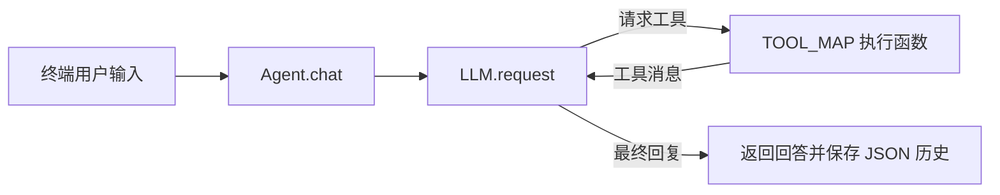

# study-agent 基础教学版

从零手写的 Python 终端 Agent。这个版本用一个完整的 ReAct 循环串起多轮对话、OpenAI 兼容模型、函数调用和本地记忆，适合逐层读清 Agent 怎样把一次自然语言请求变成实际的工具动作。

本分支归档阶段 1–8，代码基线对应 Git 标签 `v0.1.0-basic`（`4130eb8`）。

## 能力与实现

| 能力 | 实现方式 | 源码 |
| --- | --- | --- |
| 终端多轮对话 | CLI 读取输入并调用 `Agent.chat()`。支持空输入跳过、`exit` 或 Ctrl+C 退出，单轮异常会在终端显示。 | [main.py](main.py) |
| 模型接入 | 从环境变量读取 API Key、服务地址和模型名称，用同步 OpenAI 客户端发起 Chat Completions 请求。 | [配置](agent/config.py) · [模型客户端](agent/llm.py) |
| 工具注册与分发 | 分别定义模型可见的 Function Calling JSON Schema 和 Python 函数映射。内置时间查询与计算器，按工具名定位函数并解码 JSON 参数。 | [工具定义](agent/tools.py) |
| ReAct 执行循环 | 模型发出工具请求后，运行时把调用与返回写入本轮请求历史，用 `tool_call_id` 对齐，再向模型发起下一步。每轮最多调度 5 步。 | [Agent 核心](agent/core.py) |
| 本地对话记忆 | 成功返回后将对话消息保存到 `memory.json`，启动时从本地读回。推理前保留系统消息与最近的历史，最多保留 40 条历史消息。 | [消息结构](agent/message.py) · [JSON 记忆](agent/memory.py) |

## 一次工具调用怎样完成

以「帮我算 25 × 4」为例，终端把输入交给 Agent，模型看到工具 Schema 后可以请求计算器。Agent 找到对应函数，把返回值作为工具消息回传模型。模型不再请求工具时，Agent 返回回答并保存这一轮对话。



## 本地启动

在仓库根目录打开 PowerShell，使用 Python 3.11 或更高版本。

```powershell
python -m venv .venv
.\.venv\Scripts\python.exe -m pip install -r requirements.txt
.\.venv\Scripts\python.exe check_env.py
if (-not (Test-Path .env)) { Copy-Item .env.example .env }
```

在 `.env` 填写 `DEEPSEEK_API_KEY`，并按模型服务配置 `DEEPSEEK_BASE_URL` 和 `DEEPSEEK_MODEL`。

```powershell
.\.venv\Scripts\python.exe main.py
```

可用「现在几点」和「帮我算 25 × 4」体验按需调用工具，输入 `exit` 结束。用 `check_env.py` 查看解释器、依赖和虚拟环境状态。

## 建议阅读顺序

1. 从 [main.py](main.py) 看输入、模型客户端、记忆和工具如何组装。
2. 进入 [agent/core.py](agent/core.py)，跟踪模型请求、工具调用和最终回复的循环。
3. 对照 [agent/message.py](agent/message.py) 和 [agent/memory.py](agent/memory.py)，看对话如何编码、保存与恢复。
